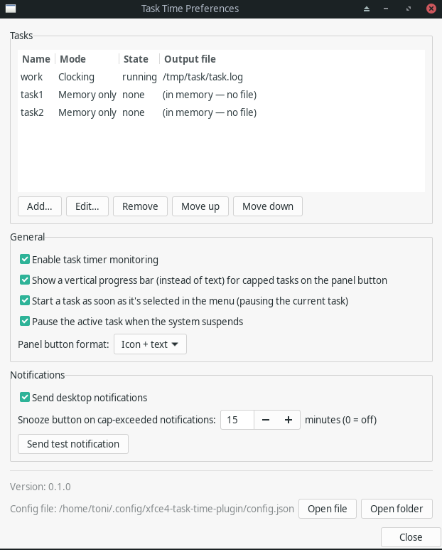
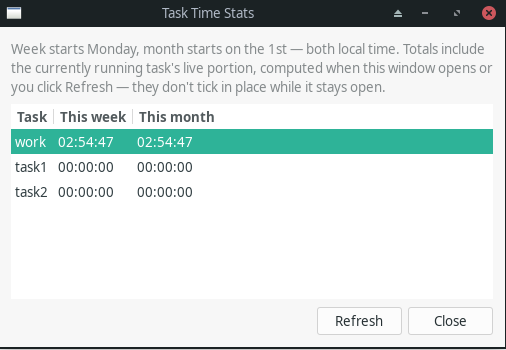

# xfce4-task-time-plugin

An XFCE panel plugin for tracking time spent on named tasks. Start, pause,
resume, and finish a task from the panel; each event is appended as one
timestamped line to that task's own configurable output file.

## Features

- Define any number of tasks. Each task's output file is **optional** — a
  memory-backed task with no file tracks time purely in RAM (nothing ever
  written to disk, at the cost of resetting on a panel restart).
- Only one task runs at a time — starting a different task automatically
  pauses whichever one was running (any number of other tasks may sit
  independently paused).
- Two output modes, chosen per task:
  - **Clocking** — `<timestamp> - <EVENT>`, with all four event words
    (defaulting to `ENTER`/`PAUSE`/`UNPAUSE`/`LEAVE`) overridable per task.
    Byte-compatible with clock-in/out journals such as
    `2026-01-12T09:44:55+0100 - ENTER`.
  - **Default (CSV)** — `<timestamp>,<task>,<EVENT>`, fixed words
    `START`/`PAUSE`/`UNPAUSE`/`FINISH`.
- A live elapsed-time label on the panel button, and a right-click-free,
  left-click menu to switch tasks, pause/resume, finish, jump straight to a
  task's own settings ("Configure…"), or open Preferences.
- Optional desktop notifications on each event.
- **Each task's output file is the source of truth**, not a private
  counter — an external script or tool can append directly to it (even
  fire a fresh Start) fully independently of the plugin, and the panel
  picks up the change, including notifications, within about a second.
- Per-task elapsed-time display: a **daily total** (sums every Enter/Leave
  cycle today, resetting at midnight — the default) or a **current
  session** (resets to zero on each Finish). A separate **Stats** window
  (panel menu → "Stats…") shows each task's rolling week/month totals.
- Optional per-task **color tag** — a small swatch shown next to the
  task's name in the panel menu, for telling tasks apart at a glance.
- Optional per-task **maximum-time cap**: past it, the duration turns red
  wherever it's shown, and (if enabled) a persistent critical-urgency
  notification fires once per crossing — with an optional "Snooze" action
  (configurable duration) to defer just that notification without needing
  the total to drop back under the cap.
- Configurable panel button format — icon + text (default), text-only, or
  icon-only, for a narrow or crowded panel.
- Optional auto-pause of the active task when the system suspends (a
  global default, overridable per task).

See [docs/CONFIGURATION.md](docs/CONFIGURATION.md) for the exact file
formats and config schema.

## Screenshots

The panel button, reflecting whatever the active task's own output file
says — no active task, a paused task, and a running task:


The Preferences dialog — task list plus General/Notifications settings:



The Stats window — each task's rolling week/month totals:



## Install

See [docs/INSTALLATION.md](docs/INSTALLATION.md) — in short:

```sh
./dev.sh install
xfce4-panel -r
```

Then add "Task Time" from the panel's Add New Items dialog.

## Development

Everything builds/tests/installs through Docker via `./dev.sh` — never run
`meson`/`ninja` directly on the host. See [CLAUDE.md](CLAUDE.md) for why.

```sh
./dev.sh build     # compile
./dev.sh test      # run the unit tests
./dev.sh install   # install into ~/.local
./dev.sh uninstall # remove what install placed
```

## Uninstall

See [docs/UNINSTALL.md](docs/UNINSTALL.md).

## License

MIT — see [LICENSE](LICENSE).
