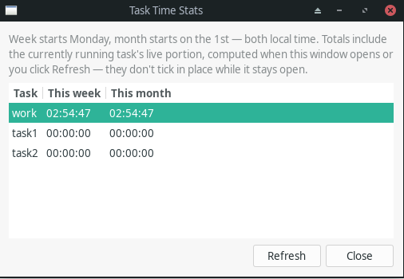

# Configuration

Configuration lives at `~/.config/xfce4-task-time-plugin/config.json` and is
managed entirely through the Preferences dialog — you shouldn't normally
need to edit it by hand, but the format is documented here for reference and
for scripting/backup purposes.

The config file only ever holds *settings* (task definitions, notification
toggle). It holds no runtime state — no "is this task running," no elapsed
time — because that's derived fresh from each task's own output file every
time it's needed. See "The output file is the source of truth" below.

## Schema

```json
{
  "config_schema_version": 1,
  "notifications_enabled": true,
  "cap_bar_enabled": false,
  "monitoring_enabled": true,
  "start_on_select_enabled": true,
  "cap_snooze_minutes": 15,
  "button_format": "icon_text",
  "auto_pause_on_suspend_enabled": true,
  "tasks": [
    {
      "id": "task-a1b2c3",
      "name": "Work",
      "output_path": "/home/you/journal/clocking.log",
      "color": "#3584e4",
      "mode": "clocking",
      "elapsed_mode": "daily_total",
      "cap_enabled": true,
      "cap_seconds": 28800,
      "cap_notify_enabled": true,
      "suspend_override": "default",
      "word_start": "ENTER",
      "word_pause": "PAUSE",
      "word_unpause": "UNPAUSE",
      "word_finish": "LEAVE"
    }
  ]
}
```

- `monitoring_enabled` is a global toggle (default `true`): master switch
  for the panel's 1-second tick — file reparsing, cap checks,
  notifications, and the live-updating display all stop while this is
  off. Set via Preferences → General → "Enable task timer monitoring".
- `cap_bar_enabled` is a global toggle (default `false`): shows a vertical
  progress bar instead of the duration text on the panel button, for
  capped tasks. Set via Preferences → General → "Show a vertical progress
  bar (instead of text) for capped tasks on the panel button".
- `start_on_select_enabled` is a global toggle (default `true`): whether
  selecting a task in the panel's left-click menu starts/resumes it
  immediately (auto-pausing whatever else is running); when off, a task
  row instead exposes an explicit "Start"/"Resume" submenu action. Set via
  Preferences → General → "Start a task as soon as it's selected in the
  menu (pausing the current task)".
- `cap_snooze_minutes` is a global setting (default `15`, 0-180): minutes a
  cap-exceeded notification's "Snooze" action defers re-notification; `0`
  removes the Snooze button entirely. Set via Preferences → Notifications
  → "Snooze button on cap-exceeded notifications" — see "Snoozing a
  cap-exceeded notification" below.
- `button_format` is `"icon_text"` (default), `"text_only"`, or
  `"icon_only"` — which of the panel button's icon and text label are
  shown, useful on a narrow or crowded panel. Set via Preferences →
  General → "Panel button format"; applies globally, not per task.
- `auto_pause_on_suspend_enabled` is a global toggle (default `true`): when
  enabled, the currently running task is paused as soon as logind reports
  the system is about to suspend (laptop lid closing, `systemctl suspend`,
  etc.) — a normal `PAUSE` event, indistinguishable in the log from a
  manual pause. It only pauses, never auto-resumes on wake. This listens
  for the signal only (no systemd sleep inhibitor lock), so it's
  best-effort rather than provably race-free, though in practice the
  signal arrives with enough lead time on every mainstream desktop. Set
  via Preferences → General → "Pause the active task when the system
  suspends". See also `suspend_override` below.
- `suspend_override` is a per-task override of the setting above:
  `"default"` (follow the global setting, default), `"always"` (always
  pause this task on suspend), or `"never"` (never pause this task on
  suspend, even if the global setting is on). Set via the task editor's
  "Pause on suspend" dropdown.
- `output_path` is **optional**. Empty (`""`) means the task is
  memory-backed instead of file-backed — see "Optional output file /
  memory-backed tasks" below.
- `color` is **optional** — a plain `"#rrggbb"` hex string, `null` when
  unset. Set it via the task editor's "Use a custom color tag" checkbox and
  color picker; when set, a small colored square appears to the left of
  that task's name in the panel's dropdown menu. Purely cosmetic — nothing
  else about the task's behavior depends on it.
- `mode` is `"clocking"` or `"csv"` — see "Output formats" below. Only
  meaningful for a file-backed task.
- `word_start`/`word_pause`/`word_unpause`/`word_finish` only apply in
  `"clocking"` mode; they're `null` for CSV tasks (CSV's four words are
  fixed). These are also what the plugin matches against when *reading*
  the file back — see "External tools" below.
- `elapsed_mode` is `"daily_total"` or `"session"` — which number the panel
  displays for this task; see "Elapsed-time modes" below.
- `cap_enabled`/`cap_seconds` are an optional maximum-time cap for this
  task; `cap_notify_enabled` controls whether crossing it sends a
  notification. See "Time cap and overtime alert" below.

## Optional output file / memory-backed tasks

A task's output file is optional. Leave it blank in Preferences (or set
`output_path` to `""`) to track a task **purely in memory**: nothing is
ever written to disk for it. This is the simplest option when you don't
need a durable record — a quick ad-hoc timer — but it comes with an
explicit tradeoff: since nothing is persisted, a memory-backed task's state
and elapsed time reset to zero whenever the panel restarts, crashes, or you
log out. A file-backed task has no such limitation (see "The output file is
the source of truth" below) — pick whichever fits what you're timing.

`mode`, the four clocking words, and the "External tools" integration below
only apply to file-backed tasks; a memory-backed task ignores them
entirely, since it never touches a file.

## The output file is the source of truth

The panel never trusts a private counter for what a task's current state or
elapsed time is — it always (re-)derives both by parsing the task's own
output file. Concretely: every second, the plugin `stat()`s each task's
file; if its modification time has advanced (or local midnight has passed)
since the last parse, it re-reads and re-parses the file and updates what's
displayed. This is what makes "External tools," below, possible.

## External tools

Because state comes from the file, not from the plugin's own memory, an
external script or tool can write directly to a task's output file — an
`ENTER`, a `PAUSE`, anything — completely independently of the plugin, and
the panel will pick it up within about a second, including:

- Showing the task as running/paused/finished based on whatever the file's
  last line says.
- Recomputing the displayed elapsed time to include that entry.
- Firing a desktop notification for the detected change (if notifications
  are enabled), the same as if you'd clicked the panel yourself.

To integrate an existing tool: point a task's output file at whatever file
that tool already writes, and set the task's four event words (clocking
mode) — or make sure your tool writes the fixed `START`/`PAUSE`/`UNPAUSE`/
`FINISH` words (CSV mode) — to match that tool's vocabulary exactly
(case-sensitive). Unrecognized words or malformed timestamps in the file are
silently skipped, so a shared or hand-edited file won't crash anything.

## Elapsed-time modes

Each task independently chooses what its displayed counter means:

- **`daily_total`** (default) — sums every `RUNNING` interval that happened
  today, across as many Enter/Leave/Pause/Unpause cycles as occurred,
  resetting only at local midnight. Example: `ENTER 09:00 → LEAVE 12:00`,
  then a later `ENTER 13:00` still running at `13:30`, displays **3:30**
  (3h from the finished morning session + 30m of the current one) — not
  just the current session's 30 minutes. Best for a continuous clock-in
  journal that may be started and stopped more than once a day.
- **`session`** — counts only since the task's most recent `START`/`ENTER`
  that hasn't yet been `FINISH`ed/`LEAVE`d, resetting to zero every time
  it's finished. Best for tracking one focused work session at a time.

## Weekly/monthly stats

The panel's own left-click menu has a **Stats…** item that opens a separate,
read-only window (independent of Preferences) showing each task's total for
the current week and current month alongside its usual daily/session
number. It reuses the same event-log aggregation as `elapsed_mode`, just
with a wider window boundary — the week starts Monday 00:00 local time
(ISO convention), the month starts on the 1st 00:00 local time.



- **Live, but not ticking.** The totals include the currently running
  task's still-open interval at the moment they're computed, the same way
  the daily total does — but they're only recomputed when the window opens
  or you click its **Refresh** button, not once a second. This also means
  the window can stay open while you edit tasks in Preferences at the same
  time; click Refresh afterward to see the updated numbers.
- **Memory-backed tasks show 0 here.** The Stats window loads its own
  independent copy of the configuration and reads totals straight from each
  task's output file — it has no access to the live panel's in-memory event
  history, so a task with no output file (see "Optional output file /
  memory-backed tasks" above) has nothing on disk to sum. This is the same
  limitation Preferences' task list "State" column already has.
- **No cap coloring.** The time cap below is explicitly daily/session-
  scoped, so it has no bearing on these week/month figures — they're always
  shown in plain text.

## Time cap and overtime alert

Each task can optionally have a maximum-time cap ("fixed work time"),
compared against whatever number that task's own `elapsed_mode` already
shows (daily total or current session):

- Once the displayed elapsed time reaches or passes the cap, the duration
  text turns red on the panel button, that task's row in the menu, and the
  tooltip — wherever it's shown.
- If "Notify when exceeded" is on for that task (and desktop notifications
  are enabled globally), a notification fires the moment the cap is first
  crossed. It uses critical urgency, so most notification daemons keep it
  on-screen until you dismiss it rather than auto-hiding — the closest
  thing to an alarm without adding an audio dependency. It fires once per
  crossing: it won't repeat while you stay over the cap, and re-arms once
  the total drops back under it (typically: the task gets Finished, which
  resets `session` to zero, or a new day resets `daily_total`) — or once a
  "Snooze" deferral you clicked on it (see below) lapses, whichever comes
  first.

The cap is set in Preferences as hours + minutes, stored internally as
`cap_seconds`.

### Snoozing a cap-exceeded notification

The cap-exceeded notification carries a **"Snooze Nm"** action button,
where N is set globally in Preferences → Notifications ("Snooze button on
cap-exceeded notifications", 0–180 minutes; default 15, and 0 turns the
button off entirely), stored as `cap_snooze_minutes`. Clicking it defers
just that notification for N
minutes — it does not require the total to drop back under the cap the
way the normal re-arm does, so it's for "yes, I know, remind me again
later" rather than "I'm done." Once the snooze window elapses, if the task
is still over cap, the notification fires again as normal.

Whether the button actually appears depends on the notification daemon
advertising support for notification actions — some minimal daemons don't,
in which case the notification still shows, just without the extra
button.

## Output formats

### Clocking mode

One line per event: `<timestamp> - <EVENT_WORD>`, where the timestamp is
`%Y-%m-%dT%H:%M:%S` followed by a numeric UTC offset with no colon
(`+0200`, not `+02:00`):

```
2026-09-02T09:15:03+0200 - ENTER
2026-09-02T09:47:12+0200 - PAUSE
2026-09-02T10:03:45+0200 - UNPAUSE
2026-09-02T12:30:00+0200 - LEAVE
```

This is byte-compatible with clock-in/out journals that use the same
`<timestamp> - EVENT` convention — set a task's output file to such a
journal and its event words to match (defaults are `ENTER`/`PAUSE`/
`UNPAUSE`/`LEAVE`, but all four are overridable per task).

### Default (CSV) mode

One line per event, no header row: `<timestamp>,<task name>,<EVENT_WORD>`,
with fixed words `START`/`PAUSE`/`UNPAUSE`/`FINISH`. The task name is
minimally CSV-escaped (quoted, with embedded `"` doubled) only if it
contains a comma, quote, or newline:

```
2026-09-02T09:15:03+0200,Client X,START
2026-09-02T09:47:12+0200,Client X,PAUSE
2026-09-02T13:00:00+0200,"Client, Y",START
```

A single CSV file can be shared by more than one task — each task only
reads back the rows whose name field matches its own.

## Task lifecycle (state machine, user-facing summary)

- Starting a task that's never run (or was finished) logs its start word and
  begins a fresh session.
- Starting a task that's paused logs its unpause word and resumes it.
- Starting a task while a *different* task is running (as last observed
  from its own file) automatically pauses the old one first (logging its
  pause word) before starting the new one — only one task the plugin
  itself starts is ever running at a time. An external tool can still start
  a second task directly in its file without going through the plugin; the
  panel will then show whichever task started most recently as the
  headline, while every task's true state stays visible in the menu.
- Starting a task while a different task is only *paused* (not running)
  leaves that other paused task untouched.
- Finishing a task logs its finish word. In `session` elapsed mode this
  resets the displayed counter to zero; in `daily_total` mode the finished
  session's time stays counted toward today's total.
