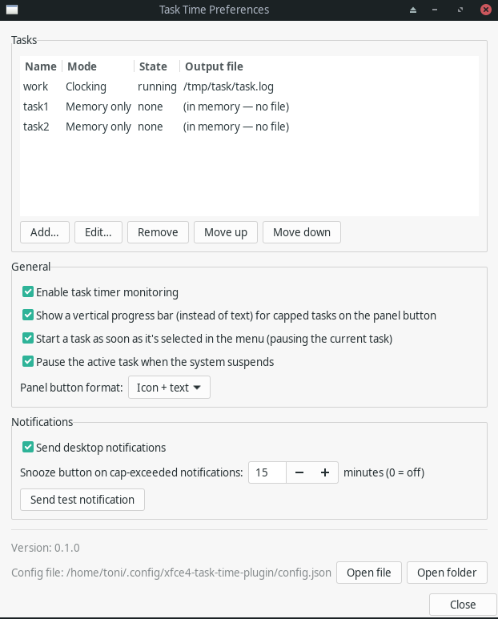

# Installation

## Option 1: Prebuilt release (recommended)

Download the release tarball and extract it into `~/.local` — no build
tools required on the host at all. Example for `v0.1.0`; check
[the Releases page](https://github.com/Desvelao/xfce4-task-time-plugin/releases)
for the current version:

```sh
curl -LO https://github.com/Desvelao/xfce4-task-time-plugin/releases/download/v0.1.0/xfce4-task-time-plugin-v0.1.0-x86_64.tar.gz
tar -xzf xfce4-task-time-plugin-v0.1.0-x86_64.tar.gz
mkdir -p ~/.local/lib/xfce4/panel/plugins ~/.local/share/xfce4/panel/plugins \
         ~/.local/share/icons/hicolor/scalable/apps
cp usr/lib/xfce4/panel/plugins/*.so ~/.local/lib/xfce4/panel/plugins/
cp usr/share/xfce4/panel/plugins/*.desktop ~/.local/share/xfce4/panel/plugins/
cp usr/share/icons/hicolor/scalable/apps/*.svg ~/.local/share/icons/hicolor/scalable/apps/
xfce4-panel -r
```

This places exactly:

- `~/.local/lib/xfce4/panel/plugins/libxfce4-task-time-plugin.so`
- `~/.local/share/xfce4/panel/plugins/xfce4-task-time-plugin.desktop`
- `~/.local/share/icons/hicolor/scalable/apps/xfce4-task-time-plugin.svg`

`xfce4-panel -r` restarts the panel so it picks up the new plugin.

## Option 2: Build from source (contributors)

Requires Docker — all building/testing/installing happens inside a
container; see [../CLAUDE.md](../CLAUDE.md) for why bare
`meson`/`ninja` is never run directly on the host in this project.

```sh
./dev.sh install
xfce4-panel -r
```

This builds the plugin inside Docker and installs to the exact same three
paths listed above.

## Add it to a panel

Right-click a panel → **Panel** → **Add New Items…** → find **Task Time** →
**Add**.

## First-run configuration

Right-click the new panel item → **Properties…** (or use the plugin's own
"Preferences…" menu item) to add your first task: a name, an output file,
and a mode. See [CONFIGURATION.md](CONFIGURATION.md) for the field reference
and exact log formats.


